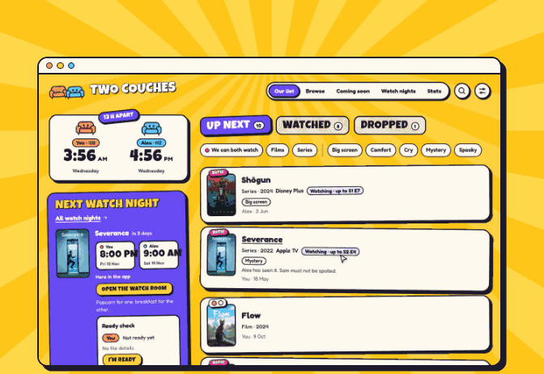
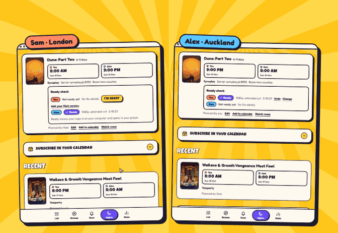
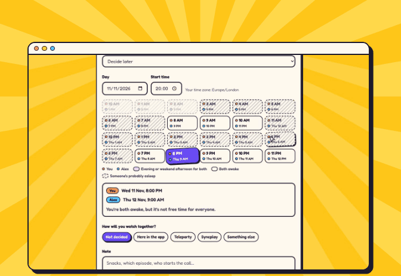
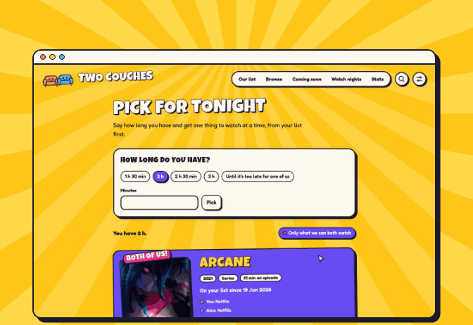
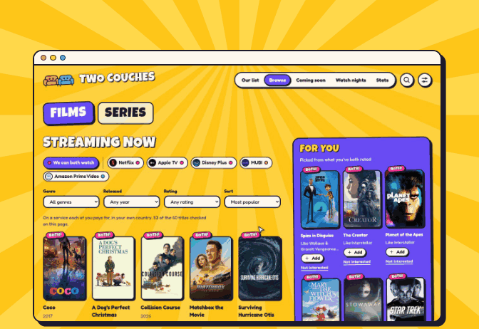
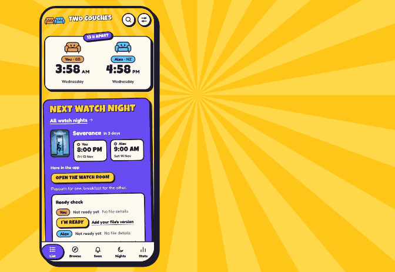
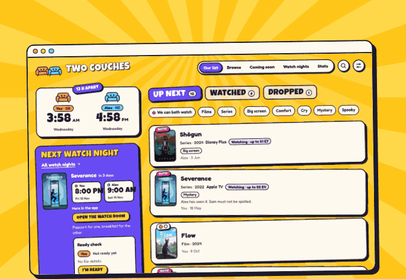

<p align="center">
  
</p>

<h1 align="center">Two Couches</h1>

<p align="center">
  <b>A shared watchlist and movie-night planner for two people in two countries.</b><br>
  Can we both stream it? What time is that for you? Are we both ready? It answers for both of you at once.
</p>

<p align="center">
  
  
  
  
  
  
</p>

---

Two Couches is built for one couple who live in different countries and watch films and series "together" from
their own couches. Each person has their own country, time zone, language and streaming services. Every screen works
out the answer for **both** of them. Streaming services hold different titles in each country, and the two clocks
are often 12 or 13 hours apart.

> The clips below use demo data: two made-up people, **Sam** in the UK (GB) and **Alex** in New Zealand (NZ),
> recorded from a local build with real TMDB posters.

## What it looks like

<table>
  <tr>
    <td width="50%" valign="top">
      
      <h3>Can we both watch it?</h3>
      Search any film or series and see both countries' services side by side. The services each of you pays for
      are ticked. A title you can both stream gets the big pink <i>Both of us!</i> burst.
    </td>
    <td width="50%" valign="top">
      
      <h3>Live on both screens</h3>
      Each night has a ready check. Each of you adds your file's version and length, and the app checks the two
      copies match. When one of you taps <i>I'm ready</i>, the other screen updates live through Supabase Realtime.
    </td>
  </tr>
  <tr>
    <td width="50%" valign="top">
      
      <h3>A time for both clocks</h3>
      The planner rates every hour of the day for both time zones: evenings and weekend afternoons are good,
      and hours when one of you is asleep are hatched out. It sends the other person a push alert and exports to any
      calendar.
    </td>
    <td width="50%" valign="top">
      
      <h3>No more scrolling</h3>
      <i>Pick for tonight</i>: say how long you have and get one title that fits. It starts with your list, then
      suggestions. Both screens land on the same pick.
    </td>
  </tr>
  <tr>
    <td width="50%" valign="top">
      
      <h3>Picked for both of you</h3>
      Browse what's streaming in each country, filtered to <i>we can both watch</i>. The <i>For you</i> row comes
      from TMDB recommendations, weighted by <b>both</b> people's ratings.
    </td>
    <td width="50%" valign="top">
      
      <h3>In your pocket too</h3>
      An installable PWA with a phone tab bar, push alerts, an offline copy of the list, and stats for each year
      (favourites you both loved, and the one you disagreed on most).
    </td>
  </tr>
</table>

### Five looks, chosen per device

<p align="center">
  
</p>

**Saturday Morning** (the default), **Sticker Scrapbook**, **POW! Comic Book** and **Candy Shop**, each with its own
palettes, including dark ones for evenings. There's also an opening animation, cartoon couch mascots and page
transitions.

## Everything it does

- **Sign-in without passwords**: an email link or a one-time code. Sign-ups are closed to an allowlist.
- **Couples**: two people join with an invite code. Postgres row-level security means each user can only ever read
  their own couple's data, enforced in the database, not just the UI.
- **Two countries, two clocks**: any country and time zone per person. Times are stored in UTC and shown in each
  person's local time. A *travelling* mode covers "I'm in GB until 20 Dec".
- **Where to watch**: streaming-service catalogues are cached from TMDB in Postgres and refreshed daily.
  "Watchable by both" means each person has a subscription that carries the title in their own country.
- **Alerts**: a daily job (pg_cron → pg_net → a Next.js route) re-checks every saved title. It sends web push
  alerts when one becomes watchable for both of you.
- **For you**: suggestions scored from TMDB recommendations, weighted by *both* people's ratings and boosted when
  both of you can stream them. *Not interested* keeps a title out.
- **Watch nights**: an hour grid rated for both time zones, then how you'll watch: here in the app, a Teleparty
  link, a Syncplay room or something else. There's a private calendar feed (`.ics`) and a ready check with
  file-version matching.
- **Watch room**: each person plays their own copy in the browser. Play, pause and seeks stay in sync over a
  private Realtime channel. The app only describes and syncs files; it never hosts, uploads or links to them.
- **After the night**: "How was it?" asks each of you for a rating and a hidden review. You can read your partner's
  review only once you've written yours.
- **Stats** per year or all time: films and series watched, hours, watch nights, month by month, top genres,
  favourites you both rated highly, and your biggest split.
- **English and Turkish** UI, following each person's settings.
- **pgTAP tests** for every security policy.

## Built with

| | |
|---|---|
| **App** | TypeScript, Next.js 16 (App Router, `cacheComponents`), Tailwind CSS, installable PWA |
| **Backend** | Supabase: Postgres with row-level security, Auth, Realtime, pg_cron + pg_net |
| **Data** | TMDB API; per-country availability from JustWatch via TMDB |
| **Extras** | Web push (VAPID), OpenSubtitles (optional, for the watch room) |
| **Hosting** | Vercel Hobby + Supabase Free: it runs entirely on free tiers |

See [`CLAUDE.md`](CLAUDE.md) for the rules, data model and roadmap, and [`DESIGN.md`](DESIGN.md) for the design system.

## Run it locally

Needs Node 24+ and Docker Desktop running.

```sh
npm install
npm run db:start          # local Supabase in Docker; prints URLs and keys
cp .env.example .env.local # paste API_URL, PUBLISHABLE_KEY and SECRET_KEY from `npx supabase status`
npm run dev               # http://localhost:3000
```

Sign in as `one@example.com` or `two@example.com` (the local allowlist in `supabase/seed.sql`).
Sign-in emails land in Mailpit at http://127.0.0.1:54324.

| Command | What it does |
|---|---|
| `npm run dev` | Next.js dev server |
| `npm run build` | Production build |
| `npm run lint` / `npm run typecheck` | ESLint / TypeScript |
| `npm run db:reset` | Rebuild the local database from migrations and seed |
| `npm run db:test` | pgTAP tests for RLS and couple rules (`supabase/tests`) |
| `npm run db:types` | Regenerate `src/lib/supabase/database.types.ts` after a migration |

New schema changes go in a new file under `supabase/migrations/` (`npx supabase migration new <name>`).

## Going live (one-time)

<details>
<summary><b>TMDB, Supabase, Vercel and the daily check</b></summary>

### 1. TMDB
Create an account at themoviedb.org, then Settings → API → request a key (personal / non-commercial).
Copy the **API Read Access Token** (the long one). That's `TMDB_API_TOKEN`.

### 2. Supabase
1. Create a project at supabase.com (Free plan; pick the region closest to you both).
2. Link and push the schema:
   ```sh
   npx supabase login
   npx supabase link --project-ref <project-ref>
   npx supabase db push
   ```
3. SQL editor: add your two real emails to the allowlist (nobody else can sign up):
   ```sql
   insert into public.signup_allowlist (email) values ('you@example.com'), ('partner@example.com');
   ```
4. Authentication → URL Configuration: set **Site URL** to your Vercel URL (e.g. `https://two-couches.vercel.app`)
   and add `https://two-couches.vercel.app/auth/confirm` to **Redirect URLs**.
5. Authentication → Email Templates: paste `supabase/templates/magic_link.html` into **Magic Link** and
   `supabase/templates/confirmation.html` into **Confirm signup**, with the subjects from `supabase/config.toml`.
   (They send a link that works on any device plus a 6-digit code, which is handy when the email opens in a
   different browser from the app. Each email is in English and Turkish, since it's sent before the app
   knows your language.)
6. Project Settings → API Keys: copy the URL, the publishable key and a secret key.

### 3. Vercel
Import the GitHub repo at vercel.com/new (Hobby plan), and add these environment variables before the first deploy:

| Name | Value |
|---|---|
| `NEXT_PUBLIC_SUPABASE_URL` | Supabase project URL |
| `NEXT_PUBLIC_SUPABASE_PUBLISHABLE_KEY` | Supabase publishable key |
| `SUPABASE_SECRET_KEY` | Supabase secret key (server only) |
| `TMDB_API_TOKEN` | TMDB read access token (server only) |
| `NEXT_PUBLIC_VAPID_PUBLIC_KEY` | Web push public key (`npx web-push generate-vapid-keys`) |
| `VAPID_PRIVATE_KEY` | Web push private key from the same pair (server only) |
| `CRON_SECRET` | Long random string; the daily job sends it to `/api/cron/daily` (server only) |

Every push to `main` then redeploys.

### 4. The daily check
`npx supabase db push` schedules it (09:00 UTC), but it does nothing until Supabase knows where to call.
In the Supabase SQL editor, using your Vercel URL and the same `CRON_SECRET` as in Vercel:
```sql
select vault.create_secret('https://two-couches.vercel.app', 'app_url');
select vault.create_secret('<CRON_SECRET>', 'cron_secret');
-- Try it now; the response lands in net._http_response a few seconds later.
select public.request_daily_check();
```
To change one later: `select vault.update_secret((select id from vault.secrets where name = 'app_url'), '<new value>');`

Then on each phone open Settings → "On this device": install the app (on iPhone: Safari → Share → Add to
Home Screen), then turn notifications on from the installed app.

Offline behaviour only shows in a production build (`npm run build && npx next start`); in `next dev` the
service worker doesn't cache anything.

</details>

---

<p align="center">
  <sub>Film and TV data from <a href="https://www.themoviedb.org">TMDB</a>. This product uses the TMDB API but is not
  endorsed or certified by TMDB. Streaming availability from <a href="https://www.justwatch.com">JustWatch</a>.</sub>
</p>
